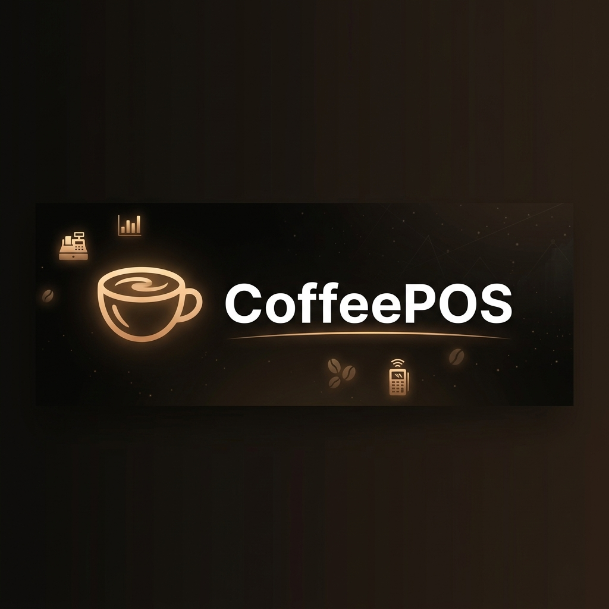

# CoffeePOS

**CoffeePOS** adalah sistem kasir (Point of Sale) modern dan cerdas yang dirancang khusus untuk kedai kopi premium. Menggabungkan efisiensi operasional dengan analitik bisnis berbasis AI, aplikasi ini dibalut dengan antarmuka "Dark Espresso" yang elegan dan responsif.

*Catatan: Proyek ini masih dalam tahap pengembangan (WIP).*

---

## 🌟 Fitur Utama

- **Smart Point of Sale**: Antarmuka kasir yang cepat dengan dukungan Quick Pay, manajemen pesanan Dine-in (dengan pencatatan nomor meja), dan Take-away.
- **Business Insight AI**: Chatbot terintegrasi yang mampu menjawab pertanyaan seputar tren penjualan, jam ramai, dan performa menu secara *real-time*.
- **Precision Waste Logging**: Fitur khusus untuk mencatat bahan baku yang terbuang (seperti susu atau kopi), yang langsung dikonversi ke nilai rupiah dan terintegrasi untuk memengaruhi HPP (Harga Pokok Penjualan).
- **Promo Engine**: Pengaturan diskon dan promo yang dinamis, dapat diatur langsung melalui manajemen produk dengan validasi harga otomatis di sistem kasir.
- **Dark Espresso UI**: Antarmuka modern yang nyaman di mata dengan estetika khas kedai kopi premium, didukung oleh palet warna *stone* dan aksen *amber*.
- **Responsive Layout**: Sidebar navigasi yang dapat dilipat (*collapsible*) dengan dukungan *flyout menu* untuk efisiensi ruang kerja layar kasir.

---

## 🛠️ Teknologi yang Digunakan

**Front-End**
- React 19
- TypeScript
- Tailwind CSS v4 (Dark Mode Native)
- Vite
- Lucide React (Icons)
- Recharts (Data Visualization)
- React Router DOM

**Back-End & Database**
- Node.js & Express
- TypeScript
- PostgreSQL (via `pg`)
- Zod (Schema Validation)

---

## 🚀 Cara Menjalankan Aplikasi

### Persiapan Database
1. Pastikan PostgreSQL telah terinstal.
2. Jalankan skrip `schema.sql` untuk membuat tabel dan struktur database dasar.

### Menjalankan Back-End
1. Buka terminal baru dan masuk ke direktori `Back-End`.
2. Jalankan `npm install`.
3. Atur file konfigurasi `.env` sesuai dengan kredensial database Anda.
4. Jalankan `npm run dev` untuk memulai server lokal.

### Menjalankan Front-End
1. Buka terminal baru dan masuk ke direktori `Front-End`.
2. Jalankan `npm install`.
3. Jalankan `npm run dev` untuk memulai *development server* Vite.
4. Buka tautan `localhost` yang muncul di terminal pada browser Anda.

---

*Dikembangkan untuk memberikan pengalaman operasional terbaik bagi bisnis kopi Anda.*
